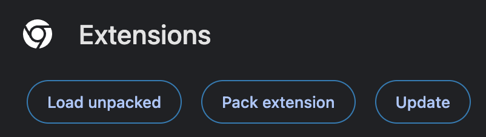

# Setup

Pre-requisites:

- Browser running the chromium engine: either Chrome or Edge
- `node`: >=18
- `pnpm`: To install follow the installation guide [here](https://pnpm.io/installation)

1. Run `pnpm install` in the root directory
2. Run `pnpm start:watch`. This should create a `dist/` directory with the code included and start watching all files in `src/`.
3. In your browser, visit your extensions
   - [Chrome](chrome://extensions/)
   - [Edge](edge://extensions/)
4. Turn on developer mode
5. Select `Load unpacked` button
   
6. Select the repo root directory directory (`VandyScheduler/`)
7. Enable the extension
8. Visit [https://more.app.vanderbilt.edu/more/SearchClasses!input.action](https://more.app.vanderbilt.edu/more/SearchClasses!input.action) to test.

# Safari

Pre-requisites:

- macOS Safari with "Add Temporary Extension…" in its Developer settings. Xcode is only needed for a permanent install.
- `node`: >=18
- `pnpm`: To install follow the installation guide [here](https://pnpm.io/installation)

1. Run `pnpm install` in the root directory
2. Run `pnpm build:safari`. This creates `dist-safari/VandyScheduler/` and `dist-safari/VandyScheduler.zip`. Pass a version to set it in the manifest, for example `pnpm build:safari 2.2.1`.

## Temporary install (no Xcode)

Safari removes temporary extensions after 24 hours or when it quits.

1. In Safari, choose Settings > Advanced and check "Show features for web developers"
2. In Settings > Developer, click "Add Temporary Extension…" and respond to the unsigned extension prompt
3. Select `dist-safari/VandyScheduler/`
4. In Settings > Extensions, enable Vandy Scheduler
5. Open [the class search page](https://more.app.vanderbilt.edu/more/SearchClasses!input.action) and [Rate My Professors](https://www.ratemyprofessors.com/) in tabs. On each one, click the Vandy Scheduler toolbar button and always allow it on that website. You can review these later in Settings > Websites.

Safari does not grant site access at install. Without access to `ratemyprofessors.com`, every professor rating shows `N/A`.

## Permanent install (Xcode)

Run the packager to generate an Xcode project, then build and run the app it creates:

```bash
xcrun safari-web-extension-packager dist-safari/VandyScheduler --project-location safari-xcode --app-name "Vandy Scheduler" --bundle-identifier com.yourname.vandyscheduler --copy-resources
```

Sign the app with your Apple ID team in Xcode. Otherwise "Allow unsigned extensions" has to be set again every time Safari launches. The same project can target iOS, which also needs Xcode.
